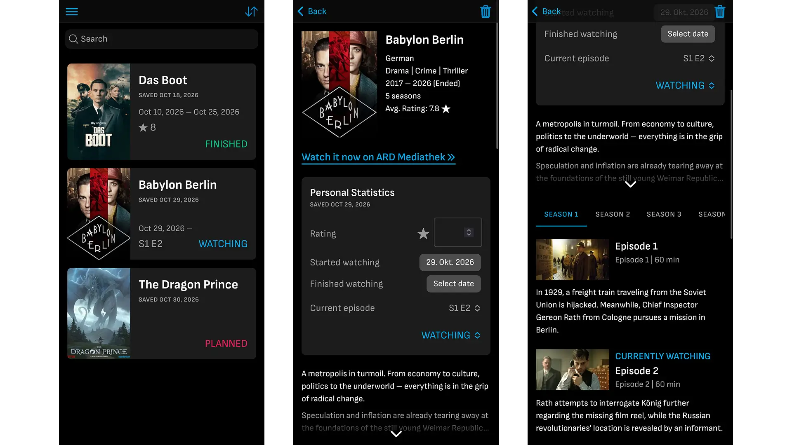
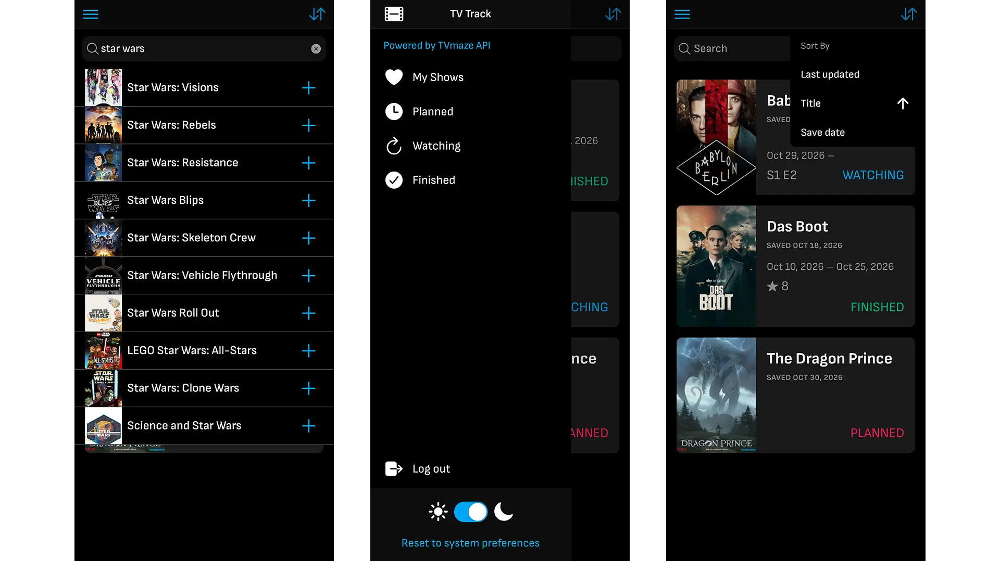

<a id="readme-top"></a>

<!-- PROJECT SHIELDS -->
<!--
*** I'm using markdown "reference style" links for readability.
*** Reference links are enclosed in brackets [ ] instead of parentheses ( ).
*** See the bottom of this document for the declaration of the reference variables
*** https://www.markdownguide.org/basic-syntax/#reference-style-links
-->

<!-- PROJECT LOGO -->
<br />
<div align="center">
<h1 align="center">TV Track (Frontend)</h1>

  <p align="center">
    Application to keep track of your favourite TV shows.
    <br />
        <a href="https://github.com/alexS317/tv-track-backend"><strong>Backend repository</strong></a>
    <br />
  </p>
</div>

<!-- TABLE OF CONTENTS -->
<details>
  <summary>Table of Contents</summary>
  <ol>
    <li>
      <a href="#about-the-project">About The Project</a>
      <ul>
        <li><a href="#built-with">Built With</a></li>
      </ul>
    </li>
    <li>
      <a href="#getting-started">Getting Started</a>
      <ul>
        <li><a href="#prerequisites">Prerequisites</a></li>
        <li><a href="#installation">Installation</a></li>
      </ul>
    </li>
    <li><a href="#usage">Usage</a></li>
    <li><a href="#roadmap">Roadmap</a></li>
    <li><a href="#acknowledgments">Acknowledgments</a></li>
  </ol>
</details>

<!-- ABOUT THE PROJECT -->

## About The Project

<div align="center">
  
  
</div>

I built this project to learn how to use the Ionic framework for cross-platform development, and also refresh and expand my Angular knowledge.

In this application, users can create an account and save the TV shows they're currently watching in a personal list. They can also track different properties, such as when they started or finished the show, their personal rating or the episode they're currently at.

For the data, the project makes use of the [TVmaze API](https://www.tvmaze.com/api) in combination with a custom backend.

<p align="right">(<a href="#readme-top">back to top</a>)</p>

### Built With

- [![Ionic][Ionic.com]][Ionic-url]
- [![Angular][Angular.dev]][Angular-url]
- [![Tailwind CSS][TailwindCSS.com]][TailwindCSS-url]

<p align="right">(<a href="#readme-top">back to top</a>)</p>

<!-- GETTING STARTED -->

## Getting Started

Here you find the instructions on how to set up the project locally.

### Prerequisites

Make sure you have the following installed:

- [node.js](https://nodejs.org/en/download) (v22 or later, LTS is recommended)

Installing the Ionic and/or Angular CLI should not be necessary for just running the project, unless you want to use specific commands such as ionic serve.

### Installation

1. Clone the repo (or download the project as a zip file)
   ```sh
   git clone https://github.com/alexS317/tv-track-frontend.git
   cd tv-track-frontend
   ```
2. Install NPM packages
   ```sh
   npm install
   ```
3. Start the development server
   ```sh
   npm run start
   ```
4. Open your browser at [http://localhost:4200/](http://localhost:4200/)

<p align="right">(<a href="#readme-top">back to top</a>)</p>

<!-- USAGE EXAMPLES -->

## Usage

To be able to use the application properly, you also have to have the corresponding backend running. In the frontend application, you can now perform essentially the same actions as with an API testing tool like Postman, but now with a proper user interface.

The authentication token, as well as some frontend-specific configuration properties, such as preferred theme or sorting configuration, are stored in the local storage (or SharedPreferences/UserDefaults on mobile devices).

You can create a new account or log in to an existing one and perform different actions:

- Search for TV shows and add them to your personal list
- Read through the details of the show and individual episodes (given they are provided by TVmaze)
- Update your personal watch statistics, remove shows that you don't want in your list anymore
- Sort and filter your shows based on different properties
- Change the application theme

<p align="right">(<a href="#readme-top">back to top</a>)</p>

<!-- ROADMAP -->

## Roadmap

Basic features:

- [x] Add choice between light and dark theme, with fallback to system preferences
- [x] Implement registration and login pages and functionality
- [x] Add list view of the user's shows on home page
- [x] Add detail view for shows
  - [x] Implement auto-saving form for custom statistics
  - [x] Add overview of seasons and episodes
- [x] Add filter options and sorting of shows list

Optional features and improvements:

- [ ] Add account details page (for editing name/email, changing passwords)
- [ ] Customize UI design further

<p align="right">(<a href="#readme-top">back to top</a>)</p>

<!-- ACKNOWLEDGMENTS -->

## Acknowledgments

- Based on [Best README Template](https://github.com/othneildrew/Best-README-Template)

<p align="right">(<a href="#readme-top">back to top</a>)</p>

<!-- MARKDOWN LINKS & IMAGES -->
<!-- https://www.markdownguide.org/basic-syntax/#reference-style-links -->

<!-- Shields.io badges. You can a comprehensive list with many more badges at: https://github.com/inttter/md-badges -->

[Ionic.com]: https://img.shields.io/badge/Ionic-3880FF?style=for-the-badge&logo=ionic&logoColor=white
[Ionic-url]: https://ionicframework.com/
[Angular.dev]: https://img.shields.io/badge/Angular-0F0F11?style=for-the-badge&logo=angular&logoColor=white
[Angular-url]: https://angular.dev/
[TailwindCSS.com]: https://img.shields.io/badge/Tailwind%20CSS-06B6D4?style=for-the-badge&logo=tailwindcss&logoColor=white
[TailwindCSS-url]: https://tailwindcss.com/
